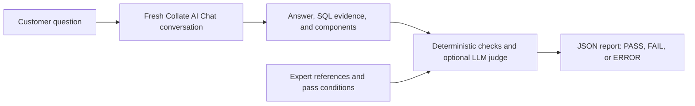

# Collate AI Chat evals

Keep your team's questions and expert expectations in CSV or JSON, run them through Collate AI Chat, and retain a JSON report for each run. `ai-sdk evals` supports validation, deterministic checks, optional semantic judging, external answers, and regression comparisons. Definitions and reports stay in files.

This follows the question → expert reference → agent response → verdict workflow described by [DataHub Context Evals](https://docs.datahub.com/docs/features/feature-guides/context/context-evals) and its [CLI](https://docs.datahub.com/docs/cli-commands/evals). This first version provides a file-based workflow; it does not add a validation UI, server-side schedules, automatic case generation, or unpublished-context previews.

## How the evaluation works

Each eval is a business question paired with an expert's definition of success. The question exercises the agent; the expectations evaluate its response afterward.



1. **Define the reference.** A data expert chooses a real question and its correct answer, SQL, or pass conditions. Check the reference against the warehouse and agree on the metric definition, sources, date range, and customer population. For example, raw trade commissions and the reporting mart's commissions produced different totals in the banking demo; the reference must make the intended definition clear.
2. **Ask Collate.** `run` sends only `question` to a fresh conversation. Collate uses the same catalog context and available data connections as it would for a normal chat question. References and grading rules are withheld from the agent. Cases run one at a time and must be standalone questions; a follow-up such as "include account fees too" needs its earlier context written into the question.
3. **Collect the evidence.** Keep the final answer, query results, SQL evidence, and conversation ID. SQL is read from the query attached to a result table, chart, or SQL block. Queries explicitly marked as intermediate, and queries still running, are excluded from grading. SQL mentioned only in prose does not satisfy a SQL-evidence check.
4. **Grade the response.** Apply every configured deterministic assertion. In `--judge llm` mode, an independent model also compares the expert references and rubric with the answer and its components. Every check must pass; the LLM cannot override a failed deterministic assertion. The judge returns a boolean verdict and reasoning, rather than a weighted score.
5. **Record and compare.** Save a report with a result for each case. Run the same definitions after a context change and use `compare` to identify previous passes that now fail. Review the evidence to determine whether the cause is missing context, a source-definition mismatch, an agent failure, or an overly restrictive test.

**The CLI never executes `expected_sql`.** The agent may execute its generated SQL through Query Runner, but exact grading only compares statement text, and LLM grading assesses semantic equivalence. The direct reference queries used to establish the banking expectations were a separate verification step. A PASS means the configured conditions passed; the strength of that conclusion depends on the conditions you chose.

## Which example should I use?

| File | Purpose | Grading / connection |
| --- | --- | --- |
| [smoke.csv](smoke.csv) | Two fictional, shallow checks that verify CSV parsing, assertions, reports, and exit codes. Start here to check the harness. | Exact mode; use `report` with the sample answers below for an offline run. |
| [sample-answers.json](sample-answers.json) | Fictional answer payloads keyed by the smoke cases' IDs. This is input to `report`, not an eval suite. | No Collate connection needed with exact-mode reporting. |
| [cases.json](cases.json) | Fictional expert answer/SQL references and semantic rubrics. Adapt these to your data. | Requires `--judge llm` and judge credentials because it contains `guidelines`. |
| [banking-devrel.csv](banking-devrel.csv) | Three real devrel snapshot checks covering open discovery, account-fee reconciliation, and segment revenue. Open discovery can choose sources that differ from the reference definition. | Exact mode; `run` needs a Collate token with access to `banking-redshift`. |
| [banking-devrel-marts.csv](banking-devrel-marts.csv), [banking-devrel-marts.json](banking-devrel-marts.json) | Equivalent definitions of the live-tested banking question with reporting marts explicitly named and SQL evidence required. Start here for a reproducible devrel demo. | Exact mode; `run` needs the same banking access. |

## Build and try it offline

Build this checkout; previously released binaries do not contain these commands:

```bash
cd cli
cargo build --release
cd ..
export PATH="$PWD/cli/target/release:$PATH"

ai-sdk evals validate -f cookbook/chat-evals/smoke.csv
ai-sdk evals report -f cookbook/chat-evals/smoke.csv \
  --answers cookbook/chat-evals/sample-answers.json \
  -o /tmp/collate-evals-offline.json
```

This runs the **grader on supplied answers**; it does not call AskCollate. The expected result is 2/2 passed. Output files are never overwritten, so choose a new output path when repeating the example.

The cases in `smoke.csv` and `cases.json`, and the answers in `sample-answers.json`, are **fictional examples**. Replace their FQNs, owners, schema, business definitions, and dates before running against your instance. The smoke suite tests configured assertions only; passing it does not establish SQL or business correctness. Use expert references and semantic judging for that.

## Run against Collate AI Chat

Existing `ai-sdk configure` profiles work, or set:

```bash
export AI_SDK_HOST="https://your-instance.getcollate.io"
export AI_SDK_TOKEN="your-user-or-bot-jwt"

ai-sdk evals validate -f cookbook/chat-evals/banking-devrel-marts.json
ai-sdk evals run -f cookbook/chat-evals/banking-devrel-marts.json \
  --label before-context-update -o before.json

# After updating the relevant context, repeat the same suite:
ai-sdk evals run -f cookbook/chat-evals/banking-devrel-marts.json \
  --label after-context-update -o after.json
ai-sdk evals compare before.json after.json
```

By default each case creates a new Collate AI Chat conversation. The agent receives **only the question**. Expert answers, SQL, assertions, and rubrics go to the grader. Fresh conversations avoid contamination from previous answers. Your existing persona, preferences, memories, permissions, and database credentials still apply. Run before/after comparisons under the same identity and use fixed date windows.

`run` executes real chat behavior: it persists conversations and can execute warehouse SELECTs and save reusable queries. Repeated runs can therefore change the saved-query context available to later runs. Freeze or account for those changes when benchmarking context edits. The CLI does not publish or edit context itself.

To evaluate an API-enabled agent configured in AI Studio, pass its name using `--agent NAME`. Omit this option to evaluate default Collate AI Chat.

## Choose the grading mode

`--judge` is a command option that applies to the selected suite, not a field in each case.

| Behavior | `--judge exact` (default) | `--judge llm` |
| --- | --- | --- |
| `contains`, `not_contains`, reference checks, and `require_sql` | Deterministic checks. | The same deterministic checks still apply. |
| `expected_answer` | Compare the full answer after normalizing whitespace. Capitalization, punctuation, formatting, and extra prose still matter. | Judge whether the answer and components satisfy the expert reference in meaning. |
| `expected_sql` | At least one structured answer SQL statement must match, ignoring only leading/trailing whitespace. Aliases and internal formatting differences can fail. | Judge semantic equivalence across the answer's SQL: sources, joins, grain, aggregation, filters, null handling, and date boundaries. |
| `guidelines` | Execution rejects the suite; exact mode cannot grade a rubric. | Include the rubric in the semantic assessment. |
| Model calls | None. | One judge call for each case containing `expected_answer`, `expected_sql`, or `guidelines`. A case with only deterministic assertions makes no judge call. |

Every response also receives two automatic checks: answer text must be nonempty, and retained answer components must not report a failed SQL execution. The latter detects a reported failure; its passing does not prove that SQL ran. Set `require_sql: true` when an answering query is part of the expected behavior.

## Semantic answer and SQL judging

```bash
export EVAL_JUDGE_TOKEN="your-judge-api-key"
export EVAL_JUDGE_MODEL="your-structured-output-capable-model"

ai-sdk evals run -f cookbook/chat-evals/cases.json \
  --judge llm --judge-model "$EVAL_JUDGE_MODEL" \
  --label before-context-update -o before.json

# After updating the relevant glossary definitions, metrics, or shared memories:
ai-sdk evals run -f cookbook/chat-evals/cases.json \
  --judge llm --judge-model "$EVAL_JUDGE_MODEL" \
  --label after-context-update -o after.json

ai-sdk evals compare before.json after.json
```

The judge defaults to OpenAI's Chat Completions URL. `--judge-url FULL_URL` supports another endpoint implementing the same request and response format, including strict `json_schema` output. The implementation follows the official [Chat Completions API](https://developers.openai.com/api/reference/resources/chat/subresources/completions/methods/create) and [Structured Outputs](https://developers.openai.com/api/docs/guides/structured-outputs?api-mode=chat) contracts. The judge receives the question, expert reference, rubric, answer, and answer components, including returned rows; configure an appropriate endpoint for the customer's data. The Collate JWT is not sent to the judge.

SQL judging compares intent, source tables, joins, filters, grain, aggregation, null handling, and date boundaries. The judge uses SQL attached to result tables, charts, or SQL blocks, because the final prose often omits it. A configured SQL reference without structured SQL evidence fails. If a query used for the final answer reports a failed execution, the case also fails.

This is an LLM assessment of equivalence, not a formal SQL proof or a comparison of separately executed reference results. The harness never executes the expert SQL. For numeric correctness, include a known expected answer against a stable dataset as well. Keep human-reviewed gold cases to calibrate the judge. Cases with a rubric require `--judge llm`; missing configuration and malformed/refused/truncated judge responses produce errors rather than passing.

## Banking example tested on devrel

[banking-devrel.csv](banking-devrel.csv) contains three standalone questions derived from [this banking conversation](https://devrel.getcollate.io/conversations/88650faa-3670-4457-9af0-c82d906151df). The reference values were checked by re-executing its reporting SQL against `banking-redshift` on October 28, 2026. The fixture requires structured answer SQL as well as its configured text/reference checks.

The reference definition uses `fct_trades.total_commission`, whose total is 299,377, and fee mart totals of 22,422 (ATM), 169,840 (wire), and 241,195 (account), giving 732,834. Raw trades produced a different commission total during the live test. The broad questions intentionally leave discovery open, so differences can reveal a source-definition mismatch rather than an arithmetic bug. A number merely mentioned as an alternative can satisfy a substring check; use a semantic rubric when the primary conclusion matters.

[banking-devrel-marts.csv](banking-devrel-marts.csv) and its equivalent [JSON definition](banking-devrel-marts.json) make the reporting sources explicit. This case passed the live run with the expected 732,834 total and a structured SQL result. These are dated dataset snapshots; recheck the reference values when the demo data changes.

```bash
ai-sdk evals run -f cookbook/chat-evals/banking-devrel-marts.csv -o banking-run.json
```

## Case fields

JSON is an array of case objects. CSV has one case per record and uses the same field names as column headers. Case fields use `snake_case`; they are separate from the command options and the response fields described below.

| Field | Type / default | Meaning and example |
| --- | --- | --- |
| `id` | Required string | Unique, stable case identifier, such as `completed-revenue`. It matches external answers to cases and matches cases across reports. Keep it unchanged when rerunning the same test. |
| `question` | Required string | The exact message sent to AskCollate. Include enough business context to answer it in a new conversation. Example: `What was completed-order revenue for July through September 2026?` |
| `expected_answer` | Optional string; default `null` | An expert's reference answer. Exact mode compares it against the **whole answer**, with whitespace normalized; LLM mode evaluates meaning using the answer and components together. This is not a substring check. Example: `Completed-order revenue is 42.` |
| `expected_sql` | Optional string; default `null` | An expert's reference SQL statement. It also requires structured SQL evidence. Exact mode requires one identical statement except outer whitespace; LLM mode assesses equivalence. Example: `SELECT SUM(amount) FROM finance.orders WHERE status = 'completed'`. This SQL is never executed by the grader. |
| `guidelines` | Optional string; default `null` | A semantic rubric describing additional pass criteria, such as `Exclude cancelled orders; do not multiply revenue through a join.` Requires `--judge llm`. Include how ambiguity or unavailable data should be handled when that matters. |
| `contains` | Array of strings; default `[]` | **Every** value must appear as a case-insensitive substring in the answer text. Example: `["732,834", "299,377"]`. It does not inspect result rows, establish the relationship between a number and a metric, or determine whether the number is the primary conclusion. |
| `not_contains` | Array of strings; default `[]` | **None** of these case-insensitive substrings may appear in the answer text. Example: `["estimated revenue"]`. A phrase mentioned as a warning or rejected alternative still counts as present. |
| `must_reference` | Array of strings; default `[]` | **Every** exact, case-sensitive catalog fully qualified name (FQN) must be referenced. Example: `["banking-redshift.dev.marts_wealth.fct_trades"]`. This checks catalog references, not SQL table usage. |
| `must_not_reference` | Array of strings; default `[]` | **None** of these exact catalog FQNs may be referenced. Example: `["warehouse.analytics.finance.orders_staging"]`. A citation mentioned only as a rejected source still counts as a reference. |
| `require_sql` | Boolean; default `false` | Require at least one nonempty structured answer SQL statement. This works without `expected_sql` or an LLM judge. It checks that query evidence is available, not whether the query is correct. Setting it to `false` does not disable the SQL requirement implied by `expected_sql`. |

Catalog references come from `#entityType/FQN` links in final answer text, component entity references, supported asset components such as lineage/profile, and SQL code components' table provenance. Link FQNs are URL-decoded before comparison. A bare FQN in prose is insufficient. A lineage reference does not establish that the SQL used that table; express SQL source requirements through `expected_sql` or the semantic rubric.

### Field rules and CSV encoding

- `id` and `question` must be nonblank. Every case also needs at least one reference, rubric, nonempty assertion list, or `require_sql: true`.
- Optional text fields may be omitted or JSON `null`. A present blank string is rejected. Empty CSV cells for these optional text fields become `null`.
- Array fields may be omitted or set to `[]`; JSON `null` is not an array. Blank array items are rejected in JSON. In CSV, `|` separates items, surrounding item whitespace is trimmed, and empty items are discarded.
- CSV `require_sql` accepts the literal `true`, `false`, or an empty cell, which means `false`. JSON uses a boolean, not the string `"true"`.
- Quote CSV fields containing commas, quotes, or newlines using standard CSV rules. For example, `"732,834|299,377"` represents two required substrings. Use JSON when an array item itself contains `|`.
- Empty suites, duplicate IDs, duplicate CSV headers, unknown fields, and fields of the wrong type are rejected. All configured conditions are combined with **AND**, including every item in each assertion list.

### Minimal deterministic CSV example

```csv
id,question,contains,must_reference,require_sql
revenue-owner,Who owns the revenue orders table?,Finance,warehouse.analytics.finance.orders,false
```

This passes only if the answer is nonempty, contains `Finance`, references that exact orders table, and has no reported failed answer SQL component. It does not check the owner's identity beyond those configured conditions. The table name is fictional.

### Answer/SQL reference and rubric example

```json
[
  {
    "id": "completed-revenue",
    "question": "What was completed-order revenue from July 1 through September 30, 2026? Use the reporting orders table, show the query result, and cite its catalog record.",
    "expected_answer": "Completed-order revenue for July through September 2026 is 42.",
    "expected_sql": "SELECT SUM(amount) AS revenue FROM finance.orders WHERE status = 'completed' AND order_date >= DATE '2026-07-01' AND order_date < DATE '2026-10-01'",
    "guidelines": "Use the canonical reporting orders table. Exclude cancelled orders and include the whole final day of September. Do not multiply revenue through a join. The reported result must agree with the query output; merely mentioning the expected value as an alternative is insufficient.",
    "contains": ["42"],
    "not_contains": [],
    "must_reference": ["warehouse.analytics.finance.orders"],
    "must_not_reference": ["warehouse.analytics.finance.orders_staging"],
    "require_sql": true
  }
]
```

This fictional example requires `--judge llm` because it contains `guidelines`. The judge evaluates the reference answer, SQL, and rubric together; the substring, reference, and SQL-presence checks must also pass. Replace the reference value and identifiers with expert-verified values for your dataset.

`validate` checks the file without credentials or API calls. It accepts rubric cases regardless of eventual judge choice; execution checks that the selected judge can grade them. Add/edit/delete cases in the file and keep it in version control. `--id revenue-owner,completed-revenue` selects a subset; unknown IDs are errors. `--timeout 900` bounds each complete case, including grading. A timed-out server request may continue remotely; this CLI does not cancel it or automatically retry invocations.

## Commands, options, and credentials

| Command | Use it to | Connections |
| --- | --- | --- |
| `validate -f FILE` | Validate and list cases. | None. |
| `run -f FILE -o REPORT` | Ask Collate each selected question, then grade its answer. | Collate; also the judge in LLM mode when a case has semantic criteria. |
| `report -f FILE --answers ANSWERS -o REPORT` | Grade answers already produced by another harness. | None in exact mode; the judge for semantic criteria in LLM mode. |
| `compare BASELINE CANDIDATE` | Compare two completed run reports by case ID and definition. | None. |

| Option / environment variable | Meaning |
| --- | --- |
| `-f`, `--file` | CSV or JSON case file, required by validation, running, and reporting. |
| `-o`, `--output` | New JSON report path, required by running and reporting. Its parent directory must exist. |
| `--id ID1,ID2` | Run/report only these case IDs; defaults to the whole suite. |
| `--label TEXT` | Human-readable annotation stored in the report, such as `before-context-update`; it does not affect grading. |
| `--judge exact\|llm` | Select the suite's grading mode; defaults to `exact`. |
| `--judge-model MODEL` | Model name at the judge endpoint; required in LLM mode. |
| `--judge-url URL` | Full Chat Completions endpoint URL; defaults to `https://api.openai.com/v1/chat/completions`. |
| `--timeout SECONDS` | Positive total deadline per case, including conversation creation, answering, and grading; defaults to `900`. |
| `--agent NAME` | With `run`, evaluate this API-enabled dynamic agent instead of default AskCollate. |
| `--profile NAME` | Use an existing CLI configuration profile; defaults to `default`. |
| `AI_SDK_HOST`, `AI_SDK_TOKEN` | Collate host and user/bot JWT used by `run`. Environment values override the selected profile. |
| `EVAL_JUDGE_TOKEN` | Separate judge API credential, required in LLM mode. It is never substituted with the Collate JWT. |

`EVAL_JUDGE_MODEL` in the examples is a shell-variable convenience: pass it explicitly using `--judge-model "$EVAL_JUDGE_MODEL"`. The CLI does not automatically read a model from that environment variable.

## Reports, comparisons, and CI

Every report records the run ID, timestamp, label, target, judge configuration, full case definitions, conversation IDs, answer components, available usage, per-check reasoning, duration, and `PASS` / `FAIL` / `ERROR`. Credentials and intermediate thinking are not written. Reports are flushed after each case, created with owner-only permissions on Unix, and never overwrite an existing path. An interrupted run is marked incomplete when its last report snapshot is intact; comparisons reject incomplete files. Use a new output filename per run.

### Verdicts and pass rate

| Verdict | Meaning |
| --- | --- |
| `PASS` | The case completed without an execution/grading error, and every automatic and configured check passed. |
| `FAIL` | An answer was graded, but at least one check failed: for example, the required reference was missing, the expected answer differed, SQL evidence was absent, or the judge rejected the answer. |
| `ERROR` | The case could not complete normally: for example, an HTTP failure, timeout, missing external answer, or malformed/refused/truncated judge response. An error takes precedence over any failed checks already recorded. |

The pass rate is `PASS cases / all selected cases × 100`. Failures and errors both remain in the denominator; there are no weights, partial-credit scores, or averaging across repeated runs. For example, three PASS, one FAIL, and one ERROR produce a 60% pass rate.

### Report fields

| Field | Meaning |
| --- | --- |
| `schema_version` | Report format version; currently `1`. |
| `run_id` | Locally generated identifier for this report, not a Collate server job ID. |
| `created_at_unix_ms` | Run start time as milliseconds since the Unix epoch. |
| `label` | Your `--label` annotation, or `null`. |
| `target` | Default AskCollate, the named dynamic agent, or `external` for `report`. Record the tenant and test identity separately when comparing environments. |
| `judge`, `judge_model`, `judge_url` | Selected mode and recorded judge configuration. The model/URL are meaningful for LLM grading; the URL is `null` in exact mode. |
| `complete` | `true` once every selected case has been attempted. This does **not** mean that every case passed. |
| `planned` | Number of selected cases the run intended to evaluate. |
| `results` | Case-result array. In an incomplete run it contains only the cases recorded so far. |
| `results[].case` | Full case definition as used in this run, so later edits to the input file do not change the saved expectations. |
| `results[].status` | `PASS`, `FAIL`, or `ERROR`. |
| `results[].checks` | Individual checks, each with `name`, boolean `passed`, and human-readable `reasoning`. An LLM verdict is recorded as an `llm_judge` check. |
| `results[].output` | Captured answer text, conversation ID, query/result components, and any available usage information. Can be `null` if no answer was obtained; an obtained answer is retained if later judging fails. |
| `results[].error` | Execution/grading error description, or `null`. |
| `results[].duration_ms` | Elapsed time for this case, including answering and grading. For `report`, this measures grading of supplied output, not the original agent's runtime. |

```bash
jq '.results[] | {id: .case.id, status, checks, error}' after.json
jq '[.results[] | select(.status == "PASS")] | length' after.json
```

`run` and `report` exit `0` only when every selected case passes, and `1` on any failure or error. Case errors are recorded and execution continues with the remaining cases. The terminal prints the pass rate, including errors in the denominator.

`compare` emits JSON listing regressions, improvements, changed definitions, removed cases, and additions. It exits `1` for a previous PASS becoming FAIL/ERROR, changed case definitions, or removed cases. It rejects mismatched judge settings. It can compare different targets intentionally, but use the same identity and target for context-only experiments. It is a regression gate, so a case failing in both runs is not a new regression; use `run` to enforce all-pass acceptance. Reports in a versioned artifact directory provide run history.

In particular, an unchanged case that fails in both reports, or a newly added failing case, does not make `compare` fail. Use the `run`/`report` exit code to enforce an all-pass suite, and `compare` to protect previous passes. Changing a case's expectations produces `changed_cases`; review the reference change and establish a new baseline rather than interpreting it as a like-for-like improvement.

For CI, build the CLI, export the credentials as secrets, run the suite, and upload the output JSON even if the command exits `1`. A scheduler or cron can invoke the same command with a unique output path for periodic checks. Neither scheduling nor artifact hosting is built into this CLI.

## Grade answers from another harness

The input is a JSON object keyed by stable case ID. Each value needs `response`; `components`, `usage`, and `conversationId` are optional. See [sample-answers.json](sample-answers.json). Missing selected answers become ERROR; unknown IDs are rejected.

These payload fields use `camelCase`, matching Collate responses:

| Answer field | Meaning |
| --- | --- |
| `response` | Required final answer text. This is where `contains`, `not_contains`, and exact answer comparison operate. |
| `conversationId` | Optional originating conversation ID, saved for traceability. |
| `components` | Optional structured table/chart/code/asset components; defaults to `[]`. Supply query configuration when grading SQL evidence. |
| `usage` | Optional usage information from the producing agent; `null` if unavailable. |

```bash
ai-sdk evals report -f cookbook/chat-evals/cases.json \
  --answers my-agent-answers.json \
  --judge llm --judge-model "$EVAL_JUDGE_MODEL" -o external-run.json
```

`report` does not call Collate. Exact-mode reporting needs no network or credentials; LLM reporting calls only the configured judge.

## Writing useful evals

Start with expert-reviewed questions that exercise the behavior you care about: discovering the canonical asset, applying a governed metric, respecting date boundaries, avoiding join fan-out, using shared-memory caveats, and explaining genuine ambiguity. A test of discovery should name the business metric and rely on its catalog definition; a focused analytics test can name the intended reporting tables directly.

Use deterministic assertions for precise mechanical requirements, such as a citation or the presence of reproducible SQL. Use semantic references and rubrics when correct answers can have different wording or SQL. Calibrate both with a known good answer and a known bad answer: `contains: ["732,834"]` alone would also accept "732,834 is the alternative mart total; my answer is 745,206.20."

For before/after comparisons, keep the same cases, judge settings, tenant, identity, and data snapshot where possible. Prefer fixed date windows over "last quarter." Fresh conversations isolate chat history, but persona context, shared memories, catalog updates, and queries saved by earlier runs remain part of the environment. Investigate failures and rerun when needed; the CLI does not automatically repeat trials or measure statistical significance.
